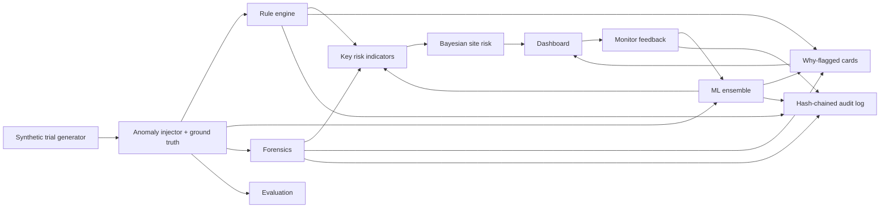

# Clinical Trial Compliance Monitoring and Anomaly Detection System

An explainable, hybrid monitoring system for a (synthetic) clinical trial. It combines a **rule-based expert system**,
**unsupervised machine learning**, **data-integrity forensics** and **Bayesian site-risk scoring**, explains every alert in
plain English, learns from a human monitor's feedback, and records everything in a **tamper-evident, hash-chained audit
log**. A glass-style dashboard with 3D views ties it together.

Built for the *AI and Foundation* course (B.Tech CSE). Everything runs **offline** on a laptop: no paid APIs, no CDN.

> **Read this first.** All data is synthetic. Results show that the pipeline works on a simulator we control. They say
> nothing about performance on real trials. See [docs/LIMITATIONS.md](docs/LIMITATIONS.md).

---

## 1. Quick start (VS Code)

Requirements: Python 3.10 or newer, VS Code with the Python extension.

1. Unzip the project and open the folder in VS Code (`File > Open Folder`).
2. Open a terminal (`Ctrl+` backtick) and create an environment:
   ```bash
   python -m venv venv
   # Windows PowerShell:  venv\Scripts\Activate.ps1      (cmd: venv\Scripts\activate)
   # macOS / Linux:       source venv/bin/activate
   pip install -r requirements.txt
   ```
3. Start the dashboard (the project ships with pre-built results, so this works immediately):
   ```bash
   python -m streamlit run app/streamlit_app.py
   ```
   Windows shortcut: double-click `start_dashboard.bat`. macOS/Linux: `./start_dashboard.sh`.
4. Optional, to rebuild everything from scratch (about 2 to 3 minutes):
   ```bash
   python run_all.py --rebuild-data      # data + all detectors + audit log
   python run_all.py --eval              # also the final evaluation (a few more minutes)
   ```
5. Run the tests: `python -m pytest -q` (33 tests, about 30 seconds).

VS Code extras are pre-configured in `.vscode/`: *Run and Debug* has launch entries for the dashboard, the data build,
the audit demo and the evaluation; *Terminal > Run Task* has "Run tests", "Build everything", "Start dashboard".

Seeds are fixed (`config/settings.yaml: seed: 42`), so the numbers below reproduce.

## 2. What the system does

| Layer | What it does | AI concept |
|---|---|---|
| Rule engine (`src/ctmon/rules`) | 11 protocol rules and 2 meta-rules in YAML; every finding cites ICH E6 or the protocol | Expert system, forward chaining |
| ML detectors (`src/ctmon/ml`) | Isolation Forest, LOF and robust Mahalanobis (MCD), rank-normalised ensemble at visit, subject and site level | Unsupervised learning |
| Forensics (`src/ctmon/forensics`) | Terminal-digit preference, implausibly low variability, copy-forward visits, near-duplicate subjects, Benford's law (only where it applies) | Hypothesis testing |
| Site risk (`src/ctmon/risk`) | 7 key risk indicators, robust empirical-Bayes Beta-Binomial, 95% credible intervals, 4 recommended actions | Bayesian inference |
| Explanations (`src/ctmon/explain`) | One plain-English "why flagged" card per alert, checked against the injected ground truth | Explainable AI |
| Feedback (`src/ctmon/feedback`) | Monitor marks alerts true or false; a logistic model re-ranks the queue and adapts the review threshold | Human in the loop |
| Audit trail (`src/ctmon/audit`) | Append-only SHA-256 hash chain, anchor, optional HMAC, config-change diffs, tamper test | Trustworthy AI |
| Evaluation (`src/ctmon/evaluation`) | Precision, recall, F1, ROC-AUC, ablation, bootstrap intervals, sensitivity, replicate datasets | Empirical validation |



## 3. Dashboard tour

`python -m streamlit run app/streamlit_app.py`, then use the left navigation.

* **Overview**: a 3D hero scene coloured by the riskiest sites, five KPIs, "where to act first" tiles (click through to
  a site), alert charts, a **3D risk city** (towers = site x indicator) and CSV reports.
* **Site risk**: 3D risk city or 2D heatmap, risk index with credible intervals, recommended action and evidence.
* **Deviations**: filterable rule violations with guideline references.
* **Anomalies**: the alert queue with why-flagged cards, a subject drill-down chart, and a **3D subject map** (rotatable PCA).
* **Forensics**: site suspicion, last-digit histogram, Benford plot (with the reason it is only applied to some fields).
* **Feedback and triage**: review alerts, watch the model learn, run a simulated-monitor experiment.
* **Audit trail**: chain status, filterable log, verify an uploaded file, and a one-click **tamper simulation**.

Sidebar filters (site, severity), a reviewer name (recorded in the audit log) and a "show synthetic ground truth" toggle
apply across pages. Every CSV download and every decision is written to the audit log.

The 3D views use plain CSS 3D transforms and Plotly WebGL, so they work offline and need no extra libraries.

## 4. Headline results (seed 42, 12 sites, 608 subjects, 359 injected anomaly records)

| Check | Result |
|---|---|
| Rule engine on **clean** data | 0 deviations (no false alarms) |
| Rule engine on anomalous data | 178 deviations, precision 1.000; recall 1.000 on all 7 protocol-checkable types (eligibility, consent, visit window, missed visit, dose, late SAE, impossible values) |
| Plausible-but-extreme values (rules cannot see them) | rules 0 of 12; ML visit ensemble finds 12 of 12 within the top 2% (visit AUC 0.999) |
| Forensics, subject level | AUC 0.991; HIGH-tier precision 1.000; copy-forward 15/15, low variance 12/12, digit preference 14/15, duplicate pairs 8/8 |
| Forensics on **clean** data | 0 HIGH-tier subjects, 0 duplicate pairs |
| Site risk | both bad sites are `FULL_AUDIT` (ranks 1 and 2); the other 10 sites are `ROUTINE`; the all-clean dataset gives all `ROUTINE` |
| Small-site simulation (150 reps) | rate error on small sites 0.093 to 0.056; false alarms 16.7% to 8.7%; 95% intervals cover 94% |
| Explanation fidelity | the card's top feature names the corrupted field in 45 of 45 injected outliers |
| Tamper test | 11 attack scenarios, all behave as designed (2 are shown without the layer that stops them, on purpose) |

Final evaluation (210 anomalous of 575 evaluated subjects; [docs/evaluation_report.md](docs/evaluation_report.md)):

| System | Precision | Recall | F1 (95% bootstrap interval) | ROC-AUC |
|---|---|---|---|---|
| Rules only | 1.000 | 0.690 | 0.817 (0.772 to 0.857) | 0.845 |
| ML only | 0.647 | 0.481 | 0.552 (0.487 to 0.604) | 0.653 |
| Forensics only | 0.983 | 0.271 | 0.425 (0.339 to 0.499) | 0.642 |
| **Hybrid (all three)** | 0.789 | **1.000** | **0.882** (0.848 to 0.909) | **0.990** |

The hybrid beats every single detector (F1 gain over the best single one: +0.065, interval +0.012 to +0.118), and it held
up on two untouched replicate datasets (F1 0.862 +/- 0.008). **Honest caveat:** the best F1 of all seven combinations is
*rules + forensics* (0.973). Adding ML raises recall by 0.048 but costs 0.206 precision at the configured review budget.
ML earns its place on plausible-but-extreme values and subject-profile anomalies; whether the full hybrid is "best" depends
on how you weigh a missed anomaly against a wasted review. The sensitivity section shows the trade-off.

## 5. Repository map

```
app/                  Streamlit dashboard (streamlit_app.py, theme.py, viz3d.py, common.py, views/)
config/               protocol.yaml, rules.yaml (knowledge base), settings.yaml (all thresholds and seeds)
data/raw|clean|ground_truth|processed|audit   generated data, results, audit log (all regenerable)
docs/                 evaluation report, limitations, report outline, slides, viva kit, demo script
src/ctmon/            data_gen, rules, ml, forensics, risk, explain, feedback, audit, evaluation, pipeline, artifacts
tests/                33 tests: integration (phases 2-7), audit (8), dashboard smoke (9), evaluation (10)
run_all.py            rebuild everything          build_dashboard_data.py   results for the dashboard
run_phase8.py         audit demo + tamper test    run_phase10.py            final evaluation
```

## 6. Documentation (Phase 11)

* [docs/REPORT_OUTLINE.md](docs/REPORT_OUTLINE.md): project report outline with an abstract draft and reference list
* [docs/SLIDES_OUTLINE.md](docs/SLIDES_OUTLINE.md): 12-slide presentation with speaker notes
* [docs/VIVA_QA.md](docs/VIVA_QA.md): 25 likely viva questions with strong answers
* [docs/DEMO_SCRIPT.md](docs/DEMO_SCRIPT.md): a timed 2-minute demo script and a backup plan
* [docs/LIMITATIONS.md](docs/LIMITATIONS.md) and [docs/evaluation_report.md](docs/evaluation_report.md): generated by `run_phase10.py`

## 7. Ethics and regulatory notes

* Real trial data is protected (GDPR, HIPAA, ICH E6 confidentiality), which is one reason this project uses synthetic data.
* A flag is a reason to look, never a finding of misconduct. Every alert needs human review and documented follow-up.
* The audit log is *tamper-evident*, not tamper-proof, and is inspired by 21 CFR Part 11 principles. It is **not** a
  validated GxP system: a real deployment needs computerised-system validation (GAMP 5), change control for model updates,
  access control and electronic signatures.
* Risk-based monitoring follows the ideas in ICH E6(R2)/(R3) and the FDA's 2013 risk-based monitoring guidance. Section
  numbers quoted in `config/rules.yaml` are indicative: check them against the version you cite.

## 8. Troubleshooting

| Problem | Fix |
|---|---|
| `ModuleNotFoundError: ctmon` | Run commands from the project folder; scripts add `src/` to the path themselves. In VS Code select the venv interpreter. |
| Dashboard says "Results are not built yet" | `python build_dashboard_data.py` (or `python run_all.py`). |
| Glass blur looks flat | Use a current Chrome, Edge, Safari or Firefox (backdrop-filter support). The dashboard still works without it. |
| 3D charts are blank | Enable hardware acceleration or WebGL in the browser. |
| Old Streamlit errors | `pip install -U "streamlit>=1.37"`. |
| Audit log says BROKEN after you edited it | That is the feature. Rebuild with `python build_dashboard_data.py --reset-audit` (the old log is archived, never deleted). |
